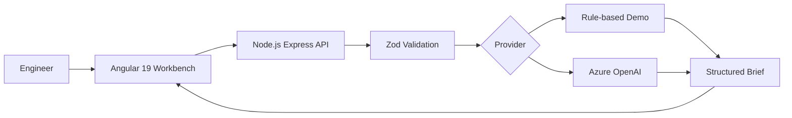

# AI Enterprise Modernization Assistant

**A portfolio-built engineering workbench for turning an application inventory into a structured modernization brief.**

This project explores an AI-assisted workflow for engineering teams: capture a sanitized system profile, surface modernization questions, organize security review prompts and create a first-pass cloud migration discussion.

> **Honest scope:** this is a portfolio MVP, not a production scanner, code auditor or autonomous migration platform. Demo mode is deterministic and rule-based. Optional Azure OpenAI mode generates advisory text from the supplied profile only. Neither mode inspects repositories, confirms vulnerabilities or changes infrastructure.

## Product experience

- Application inventory form with a realistic synthetic example
- Structured modernization opportunities
- Security review prompts (not verified findings)
- Cloud migration considerations
- Suggested next steps
- Deterministic demo mode that runs without an AI key
- Optional Azure OpenAI adapter
- API validation, CORS allowlist, Helmet headers and request-size limit
- Docker and OpenShift starter deployment assets

## Architecture



See [architecture](docs/architecture.md), [security notes](docs/security.md) and [demo script](docs/demo-script.md).

## Technology

| Layer | Implementation |
|---|---|
| Frontend | Angular 19, TypeScript, standalone component |
| API | Node.js 20+, Express, TypeScript |
| Validation | Zod |
| AI integration | Optional Azure OpenAI Chat Completions |
| Local deployment | Docker Compose |
| Container platform | OpenShift-compatible Kubernetes manifests |

## Run locally

Requirements: Node.js 20+ and npm.

### Start the API

```bash
cd backend
cp .env.example .env
npm install
npm run dev
```

API health: http://localhost:4000/health

### Start the Angular app

In another terminal:

```bash
cd frontend
npm install
npm start
```

Open http://localhost:4200.

The UI uses the API URL configured in `frontend/src/environments/environment.ts`. Set a real API origin in `environment.prod.ts` before building for deployment.

### Optional Azure OpenAI mode

Set these values in `backend/.env`:

```dotenv
AZURE_OPENAI_ENDPOINT=https://YOUR-RESOURCE.openai.azure.com
AZURE_OPENAI_API_KEY=YOUR-KEY
AZURE_OPENAI_DEPLOYMENT=YOUR-DEPLOYMENT
AZURE_OPENAI_API_VERSION=2024-10-21
```

The API key stays on the server. Never commit `.env` or expose secrets in screenshots or demo recordings. Confirm the API version and deployment configuration against the Azure resource you use.

### Docker Compose

```bash
docker compose up --build
```

The compose file starts the API on port 4000 and web UI on port 4200. Update the frontend API origin and CORS allowlist to match real deployment hosts.

## Example synthetic inventory

```json
{
  "projectName": "Claims Portal",
  "technology": "Angular 15 + Java 11 + DB2 + Redis 6 + OpenShift",
  "description": "A customer-facing claims portal with an Angular frontend calling Java REST services. DB2 stores transactional data, Redis supports caching, and containerized services run on OpenShift.",
  "dependencies": ["Angular 15", "Java 11", "Redis 6"]
}
```

## API

- `GET /health` returns service status and active provider mode.
- `POST /api/analyze` accepts `projectName`, `technology`, `description` and optional `dependencies`.
- Invalid payloads receive HTTP 400. Provider failures receive a generic HTTP 502 response.

## Roadmap

1. Add Entra ID/OIDC authentication, RBAC and tenant isolation.
2. Integrate approved SCA/SAST/container tools and display source-linked evidence.
3. Add document ingestion, embeddings and RAG with citations.
4. Persist analysis history with explicit retention and deletion controls.
5. Add automated evaluation, prompt regression tests, audit trails and rate limits.
6. Add CI checks, SBOM generation, secret scanning and signed container images.

## Responsible use

- Use synthetic or authorized sanitized data only.
- Treat model output as hypotheses and discussion prompts, not facts.
- Never claim a CVE is confirmed unless verified by a trusted scanner.
- Require human approval for code changes, infrastructure plans and deployments.
- Do not upload employer code, customer records, secrets or internal documents without explicit authorization.

## Originality and attribution

This is a custom portfolio implementation created for this project. It uses common open-source frameworks and documented platform APIs; it does not include employer source code or claim ownership of third-party libraries. No originality checker can guarantee that an idea, phrase or code pattern has never appeared elsewhere; review and attribute any third-party material added later.
