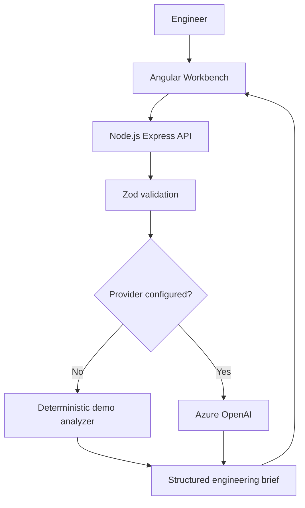

# Architecture

## Request lifecycle
1. Engineer enters a sanitized project profile and dependency names.
2. Angular submits a bounded JSON payload.
3. Express applies security headers, CORS policy, body-size limit and Zod validation.
4. API uses deterministic heuristics unless Azure OpenAI settings are present.
5. Response includes modernization, security review, migration and next-step sections.

## MVP boundaries
- Stateless API; no file uploads, persistence or database.
- No repository cloning, code execution, scanner integration or automated remediation.
- AI output is advisory and based only on supplied profile text.
- Production requires a real API origin and matching CORS allowlist.
